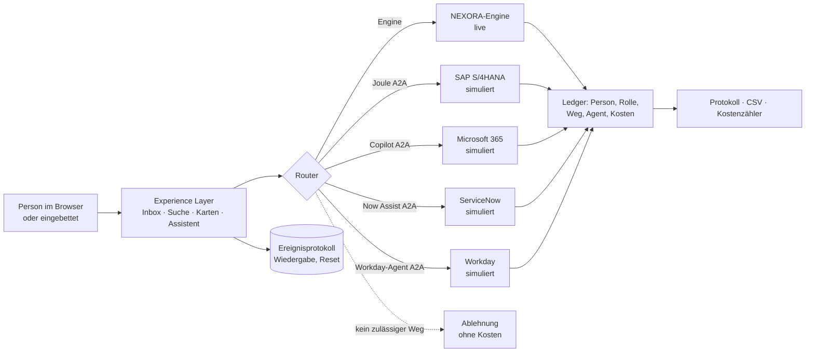

# NEXORA AI Suite

*NEXORA AI – A brand of TRUESCALE*

KI-native Enterprise-Plattform als vollständig klickbare Demo mit drei verbundenen Digital Twins:

- **Elevon Industries** (Aufzugshersteller)
- **NovaMart Retail** (Handel)
- **Aventra Consulting** (Beratung)

Alle Daten sind synthetisch und werden reproduzierbar erzeugt (Seed 20261102). Es gibt keine realen Kunden-, Preis- oder Vertragsdaten.

## Aufbau

| Pfad | Inhalt |
|---|---|
| `src/engine.js` | Business-Engine (UMD, ohne Abhängigkeiten). Sie umfasst: doppelte Buchführung mit Perioden und Belegnummern; Nebenbücher, die mit dem Hauptbuch abgestimmt sind; Rollen und Berechtigungen; Idempotenz; atomare Befehle; den Nachrichtenaustausch zwischen den Unternehmen; die Rücksetzung je Mandant. |
| `src/app.js`, `src/app_ext.js` | Oberfläche, geführte Demos, Live-Änderungen und Backend-Anbindung |
| `test/engine.test.js` | 47 Akzeptanztests: Buchungslogik, Reproduzierbarkeit, alle E2E-Prozesse |
| `test/e2e.py` | Playwright-Browsertest. Er spielt alle 13 Demo-Storys durch, prüft Konsistenz und Reset, Experience Layer, Ablösung, Einbettung und Marktposition und erzeugt Screenshots. |
| `test/visual.py` | Pixelvergleich der Suite-Ansicht gegen eine Referenz (`save` / `compare`, `--inhalt` ohne Seitennavigation) |
| `src/pe.js`, `src/app_pe.js`, `src/pe.css` | PE Command Center: Rechenkern (in Node testbar) und Oberfläche |
| `test/pe.test.js`, `test/pe.bench.js` | Tests (Kennzahlen, Fonds, Mandantentrennung) und Leistungsmessung des PE-Rechenkerns |
| `src/dxf.js` | DXF-Leser: Schriftfeld- und Positionsattribute, Geometrie, Schnittlängen aus Abwicklungen |
| `samples/MR-1200.dxf` | Synthetische Werkstattzeichnung Maschinenrahmen, 2 Blätter A1, 15 Positionen (`samples/make_mr1200.py`) |
| `samples/SK-200.dxf` | Einfache Beispielzeichnung Schachtkonsole (`samples/make_sk200.py`) |
| `src/connectors.js`, `src/app_v8.js`, `src/layer.css` | Experience Layer: Konnektoren (NEXORA live, übrige simuliert), Router, Agenten, Protokoll, Einbettung |
| `test/connectors.test.js` | Tests der Konnektor-Schicht (Determinismus, Reset, Rechte, Wege, Kosten, Vier-Augen, Router) |
| `build.py` | Erzeugt die Einzeldatei `dist/nexora-suite.html` sowie `dist/mcp-tools.json` und `dist/agent-card.json` |

## Prozesse

| Prozess | Stand |
|---|---|
| Lead-to-Cash mit Fertigung und Montage | Live-Engine |
| Retail Order-to-Cash | Live-Engine |
| Project-to-Cash | Live-Engine |
| Unternehmensübergreifende Ketten | Live-Engine |
| Service-to-Cash | Live-Engine |
| Maintain-to-Operate | Live-Engine |
| Retouren | Live-Engine |
| Click & Collect | Live-Engine |
| HR: Stamm, Abwesenheiten, Personalkostenplanung | Live-Engine |
| Datenmigration mit Vier-Augen-Freigabe und Cutover | Live-Engine |
| Design-to-Make: Zeichnung → Stückliste, Arbeitsplan, Bezugsquellen → Fertigung mit Vorgängen und Lohnbearbeitung | Live-Engine |
| Einkauf direkt (aus Bedarfsplanung) und indirekt (Katalog, Freitext, Freigabegrenzen, Kostenstellen) | Live-Engine |
| HR Recruiting und Onboarding mit Ausstattungsanforderungen | Live-Engine |
| Payroll | Bewusst Platzhalter |
| Transformation | Prototyp |

## Rollen und Accounts

Jedes Unternehmen hat ein Rollenkonzept mit Berechtigungen, die die Engine bei jedem Befehl prüft:
- CEO
- CFO
- Controller
- Vertrieb
- Einkauf
- Lager
- Fertigung
- Service
- Filialleitung
- Projektleitung
- Beratung
- Resource Manager
- HR
- Migration Manager
- Prüfer mit reinen Leserechten

Jede Person, mit der die Seite geteilt ist, kann sich je Unternehmen einen eigenen Account mit frei wählbarer Rolle anlegen und sofort damit arbeiten. Der Account hängt an ihrem claude.ai-Konto und ist Teil des Ereignisprotokolls. Er ist deshalb reproduzierbar und wird beim Zurücksetzen entfernt. Accounts erhalten keine automatische Rechte-Erhöhung.

## Live-Demo

- **Meine Aufgaben:** Freigaben, Posteingang und Einplanungen je Rolle, abgeleitet aus dem Zustand der Engine. Was ein Gerät anstößt, erscheint auf dem anderen sofort. Ein QR-Code öffnet die Seite auf dem Handy.
- **Präsentationsmodus (Taste P):** größere Schrift, ohne Entwicklerhinweise.
  - Pfeiltaste → oder Leertaste: nächster Schritt.
  - Taste N: Sprechertext.
  - „Springen zu“: führt alle vorherigen Schritte echt aus.
- **Fernbedienung:** Ein zweites Gerät desselben Kontos zeigt den Sprechertext und schaltet weiter.
- **Demo vorbereiten:** Zurücksetzen, Selbsttest, Prüfliste (Datenbank, Live-Raum, Claude, Google Drive) und QR-Code.
- **Belege als PDF:** Angebot, Auftragsbestätigung, Lieferschein, Bestellung, Rechnung und Fertigungsauftrag mit Arbeitsanweisungen und QR-Code. Download oder Ablage in Google Drive.

## Zeichnungsimport

- **DXF (ASCII):** wird exakt gelesen.
  - Das Schriftfeld ist ein Block mit dem Attribut `ZEICHNUNGSNR`. Weitere Attribute: `BENENNUNG`, `REVISION`, `OBERFLAECHE`, `NAHTLAENGE`, `NAHTDICKE`.
  - Positionen sind Blöcke mit dem Attribut `POS`. Weitere Attribute: `BENENNUNG`, `MENGE`, `ART`, `WERKSTOFF`, `DICKE`, `LAENGE`, `BREITE`, `BIEGUNGEN`, `BOHRUNGEN`, `BOHR_D`, `NORM`, `TEILENR`.
  - Die Abwicklung eines Blechteils liegt auf dem Layer `POS-n`. Daraus berechnet die Seite die Schnittlänge.
- **PNG/JPG:** Claude erkennt die Stückliste. Das Ergebnis ist ein Vorschlag, der vor der Übernahme geprüft wird.
- **DWG/STEP:** werden nicht im Browser gelesen. Bitte im CAD-System als DXF exportieren.

## Experience Layer

Seit v0.8 hat die Suite zwei Ansichten. Standard ist der „Experience Layer“: eine herstellerneutrale Oberfläche über mehrere Systeme, in der die NEXORA-Engine ein Konnektor unter mehreren ist. Der Umschalter oben führt zur „Suite“-Ansicht, die unverändert wie v0.7 funktioniert; die Wahl wird im Browser gespeichert. `index.html?layer=1` bzw. `?layer=0` erzwingt eine Ansicht.



**Was echt ist und was simuliert**

| Teil | Stand |
|---|---|
| NEXORA-Engine (Buchungen, Prozesse, Rechte) | Live-Engine |
| SAP S/4HANA, Microsoft 365, ServiceNow, Workday | **Simuliert**: deterministisch aus dem Seed, ohne Netzwerkzugriff, keine echte Integration |
| Agenten Joule, Copilot, Now Assist, Workday-Agent | **Simuliert** (Agentenkarten im A2A-Stil) |
| Kosten je Zugriffsweg | Beispielwerte, keine Herstellerpreise |
| Claude als Assistent | echt im claude.ai-Artefakt; schlägt nur vor, bucht nichts |

**Konnektor-Schnittstelle** (`src/connectors.js`, UMD, in Node testbar):

- `listTasks(w, tid, ctx)`: Aufgaben aller Systeme im einheitlichen Kartenformat. Jede Karte hat Quelle, Zugriffsweg, Referenz, Felder und Aktionen.
- `search(w, tid, q, ctx)` und `getObject(w, tid, ref)`: Suche und Deep Links über alle Systeme (Referenz `system:art:id`).
- `dispatchAny(E, w, tid, "conn.<system>.<befehl>", params, ctx)`: ein Befehlsweg für alles.
  - Der Aufruf ist atomar und wird mit Rechteprüfung ausgeführt.
  - Er schreibt einen Ledger-Eintrag mit Person, Rolle, Weg, Agent und Kosten.
  - Unzulässige Wege lehnt er mit `ROUTE_NOT_ALLOWED` ab.
- `AGENTS` und `routeQuery(text)`: Agenten-Register und Router.
- `ROUTES` und `ALLOWED`: die Kostentabelle (Beispielwerte) und die erlaubten Wege je Befehl.
- `costs(w, tid, {date|period})`: Summen für Kostenzähler und Protokoll.
- Der Zustand hängt am Mandantenobjekt. Ein Reset eines Unternehmens setzt deshalb auch seine Konnektoren zurück. Ohne Konnektor-Ereignisse bleiben die Engine-Hashes unverändert.

**Ansichten:** Dashboard (Kacheln je Person, Vorlagen je Rolle), Meine Aufgaben (Inbox), AI Assistant mit Aktionskarten, Systeme, Agenten, Ablöse-Cockpit, Protokoll (CSV-Export) und „Mitbestimmung & Datenschutz“ im Demo Control Center.

**Vom Layer zum eigenen ERP (Ablöse-Cockpit):** Jeder Prozess hat ein System of Record (`processOwner`). Inbox, Karten, Suche und Dashboard lesen über diese Zuordnung. Der Prozess „Bestellanforderung“ lässt sich von SAP (simuliert) auf die NEXORA-Engine umstellen:

1. Datenübernahme über das bestehende Migrationsmodul (Migrationsprojekt `sap-pr`): Testlauf, Fehlerliste, Regeln, Vier-Augen-Freigabe, Produktivlauf und Abstimmung.
2. Parallelbetrieb: Neue Vorgänge entstehen in der Engine und werden ins Altsystem gespiegelt; die Abstimmung vergleicht Stückzahl und Summe.
3. Umschalten nur bei Differenz 0. Danach ist das Altsystem für den Prozess lesend.
4. Rückweg bis zum Umschalten: Das Altsystem führt wieder, offene NEXORA-Vorgänge werden zurückgezogen.

Die Karten in der Inbox sehen vorher und nachher gleich aus, nur Quelle und Zugriffsweg ändern sich. Andere Prozesse sind in dieser Demo nicht umstellbar und so gekennzeichnet.

**Storys im Experience Layer:** `crosssys` (Freigabe über Systemgrenzen), `oneday` (Ein Tag im Experience Layer), `replace` (Prozess für Prozess ablösen). Direkt starten mit `index.html?story=<id>`.

**Einbettung:** `index.html#embed` oder `index.html?embed=1` zeigt eine kompakte Vorschau für etwa 400 px Breite, nur mit Inbox und Assistent. So würde NEXORA z. B. in Teams oder Copilot laufen. Eine echte Einbettung ist das nicht.

**Offene Standards (statische Vorführdateien, kein laufender Server):**

- `dist/mcp-tools.json`: Werkzeugliste des Assistenten mit Name, Beschreibung und `inputSchema`. `build.py` erzeugt sie aus `AI_TOOLS`.
- `dist/agent-card.json`: A2A-artige Agentenkarte des NEXORA-Agenten mit Fähigkeiten und delegierten (simulierten) Agenten.

**Grenzen:**

- KI bucht nichts. Ausgeführt wird nur nach Klick und Bestätigung eines Menschen.
- Direkter Agentenzugriff auf SAP-Tabellen oder -Schnittstellen wird abgelehnt. Der Hinweis bezieht sich auf die SAP API Policy (v4/2026), ausdrücklich ohne Rechtsbewertung.
- Keine Herstellerlogos; Herstellernamen stehen nur als Text.

## PE Command Center (v0.9.7)

Ein Bereich **Private Equity** in derselben Navigation, für PE-Investoren. Plan, Datenmodell, Berechtigungsmodell und Roadmap stehen in [`docs/pe-command-center.md`](docs/pe-command-center.md).

- **Demo-Umgebung:**
  - Investor „Nexora Global Equity Partners“ mit drei Fonds (10/8/7 Unternehmen, 25 insgesamt) und 36 Monaten Historie.
  - Verschiedene Länder, Währungen, ERP-Systeme, Rechnungslegungsstandards und Beteiligungsquoten.
  - Ein zweiter Investor („Rheintal Capital“) prüft die Mandantentrennung.
  - Ein dritter Investor („Nordlicht Beteiligungen“) hält die Engine-Mandanten Elevon, NovaMart und Aventra (Modell B). Ihre Zahlen ab Nov 2025 kommen aus den Buchungen der NEXORA-Engine.
  - Alles ist **synthetisch** und deterministisch aus dem Seed erzeugt; ERP-Anbindungen sind simuliert.
- **Rechenkern** `src/pe.js` (UMD, in Node testbar):
  - Lokale Kontenpläne je ERP-Familie werden auf den Konzernkontenplan gemappt.
  - Umrechnung in EUR: Flüsse zum Durchschnittskurs, Bestände zum Stichtagskurs.
  - Kennzahlen mit Formel und Ebene in `PE.KPI_DEFS`.
  - Fondskennzahlen (Paid-in, NAV, DPI, RVPI, TVPI, MOIC, Gross/Net IRR per XIRR auf datierten Cashflows) stehen getrennt von den operativen Kennzahlen.
  - Die Bilanzidentität wird erzwungen und getestet.
- **Berechtigung:**
  - Jede Lesefunktion verlangt einen Principal. Sie prüft Organisation, Fonds, Unternehmen, Rollen-Obergrenze und die Datenfreigabe des Unternehmens (Kennzahlen, Abschlüsse oder bis zur Buchung).
  - Die Prüfung läuft im Rechenkern der Seite, nicht auf einem Server; die Server-Absicherung ist Teil der Zielarchitektur.
- **Ansichten:**
  - PE Command Center: Kennzahlen, Diagramme, Ranking, Risiko-Heatmap, Verteilung nach Land und Branche mit Klick-Filter, Fondstabelle, regelbasierte Hinweise.
  - Portfolio Companies.
  - Unternehmensdetail mit Drill-down Unternehmen → Gesellschaft → Konto → Buchung.
  - Administration: Organisation, Fonds und Unternehmen anlegen, mit Rollenprüfung.
  - Financial Intelligence, Cash & Liquidity, AI Financial Advisor, ERP Integration Hub, Konsolidierung, Investment Performance mit Exit-Simulation, Value Creation, Risk Intelligence, Portfolio Onboarding und ERP-Transformation (Szenarien A–D mit Beispielwerten, keine Herstellerpreise). Details je Phase im CHANGELOG.
- **Aggregation:** Portfolio-Summen sind eine Management-Aggregation zu 100 % der aktiven Unternehmen, nicht anteilig und keine Konsolidierung. Unternehmen im Onboarding sind ausgeschlossen und werden benannt.
- **Tests:** `node test/pe.test.js` (60 Tests, in CI) und `python test/e2e.py` (Block „PE Command Center“). Leistungsmessung des Rechenkerns: `node test/pe.bench.js 100` (2.500 Unternehmen). Stresstests: `node test/pe.stress.js` und `python test/ui.stress.py`, Ergebnisse in [`docs/stresstest.md`](docs/stresstest.md).

## IT-Infrastruktur und Sizing (v0.9.9)

Seite „IT-Infrastruktur“ in der Suite (je Mandant, live aus Engine und Konnektoren) und im PE-Bereich (Portfolio und je Unternehmen, Integrationsstatus live aus dem Hub). Sizing mit Formeln, Ziel NEXORA und Was-wäre-wenn. Alles Beispielwerte – keine Herstellerangaben. Details: [`docs/it-infrastruktur.md`](docs/it-infrastruktur.md). Tests: `node test/infra.test.js`.

## Marktposition pflegen

Die Positionierungsmatrix „Wer liefert die eine Oberfläche für alle Anwendungen?“ steht auf der TRUESCALE-Seite unter `truescale.html#markt`. Die Suite verlinkt sie in der Navigation („Marktposition · TRUESCALE“). Die Referenzumsetzung liegt in `docs/positionierung-referenz.html`.

- **Daten:** alles im Objekt `MARKET` in `src/market.js`. Dort stehen Punkte der Karte (`points`), Zeilen der Matrix (`rows`), Kriterien, variable Texte und Quellen. Karte und Tabelle werden daraus gezeichnet; `python build.py` baut die Seite neu.
- **Stand-Datum:** `asOf` und `asOfLabel` bei jeder inhaltlichen Aktualisierung anpassen. Die Angabe erscheint im Kopf des Abschnitts.
- **Quellen:** neuen Eintrag `{ label, url }` in `sources` ergänzen. Bewertungen nur mit Beleg ändern; ohne belastbare Angabe die Bewertung 0 (Strich) setzen.
- **Öffentliche und interne Fassung:**
  - Standard ist die öffentliche Fassung (`MARKET_INTERNAL = false`). Sie hat keinen Punkt und keine Zeile „NEXORA heute“ und keinen Umbau-Pfeil. Die eigene Zeile heißt „NEXORA × truescale · Roadmap“ und ist als „geplant“ markiert.
  - Die interne Fassung entspricht der Referenz und öffnet sich über `truescale.html#markt-intern`.
  - Einträge nur für intern bekommen `internal: true`, öffentliche Ersatztexte stehen in `publicName`, `publicSub`, `publicMaturity` und `texts.*.public`.
- **Farben:** Kategorien- und Bewertungsfarben sind Tokens in `src/base.css` (`--cat-*`, `--rate-*`, `--quad`) für Hell und Dunkel.

## Lokal ausführen

```bash
node test/engine.test.js
node test/connectors.test.js
node test/pe.test.js
python build.py
python test/visual.py compare <Referenzordner>   # optional: Suite-Ansicht pixelgleich
pip install playwright && python -m playwright install chromium
python test/e2e.py
```

Die veröffentlichte Version nutzt eine gemeinsame Datenbank als Ereignisprotokoll. Die Welt entsteht immer aus Seed und Protokoll und ist daher reproduzierbar. Ist die Datenbank nicht verfügbar, speichert die Seite das Protokoll lokal im Browser. Google Drive dient für Sicherung, Export und Wiederherstellung. Claude dient als Assistent mit lesenden Engine-Werkzeugen und bucht nichts selbst.
