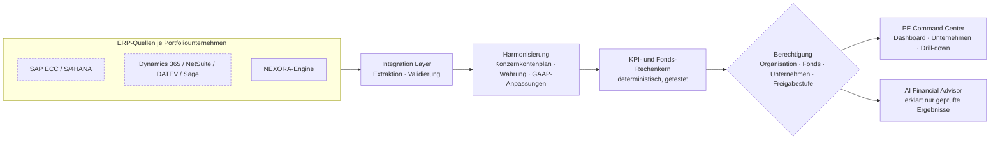

# NEXORA PE Command Center – Analyse und Umsetzungsplan

*NEXORA AI – A brand of TRUESCALE*

Stand: 05.11.2026. Dieses Dokument ist das Ergebnis von PE-Phase 1 („Architecture & Foundation“). Es beschreibt:

- die vorhandene Architektur der NEXORA AI Suite,
- was davon für das Private-Equity-Modul wiederverwendet wird,
- welche Fähigkeiten fehlen,
- welche Zielarchitektur gilt,
- was die Demo davon ehrlich umsetzt.

## 1. Ist-Architektur (geprüft)

| Bereich | Stand in v0.8 |
|---|---|
| Auslieferung | Eine HTML-Datei (`build.py` setzt `src/*` zusammen). Läuft auf GitHub Pages und als claude.ai-Artefakt. Kein eigener Server. |
| Frontend | Vanilla JS ohne Framework. Hash-Routing (`MODS`, `ROUTES`, `VIEWS[route]()`), Aktionen über `data-act` → `ACT.*`. Erweiterungen per Wrapper in neuen Dateien (`app_v6.js` … `app_v8.js`). |
| Business-Logik | `src/engine.js` (UMD, in Node testbar). Die Welt entsteht aus Seed und Befehlsprotokoll; Befehle laufen über `E.dispatch(W, mandant, befehl, parameter, ctx)`. |
| „Datenbank“ | Ereignisprotokoll: lokal im Browser oder gemeinsam über die Artefakt-Datenbank (`claude.use("db")`) mit Zugriffsregeln je Pfad. Der Zustand wird bei jedem Öffnen deterministisch neu berechnet. |
| Authentifizierung | Bei claude.ai das Konto der Betrachter (`claude.use("user")`), sonst keine. Demo-Rollen und Accounts je Mandant im Protokoll. |
| Autorisierung | `need(t, ctx, perm)` in der Engine prüft jede Aktion gegen Rolle und Rechte. Die Oberfläche blendet nur aus; maßgeblich ist die Engine. |
| Finanzfunktionen | Doppelte Buchführung, Perioden, Nebenbücher mit Hauptbuch-Abstimmung, GuV und Summenbilanz, Kennzahlen (`E.kpis`, `E.plOf`, `E.trialBalance`), Migration mit Vier-Augen-Freigabe. |
| KI | Claude über `claude.use("sample")` mit lesenden Werkzeugen (`AI_TOOLS`) und Regel-Rückfall. Die KI bucht nichts. Antworten nennen Datenbasis, Zeitraum und Berechnung. |
| Integration | Experience Layer (`src/connectors.js`): simulierte Konnektoren, Router, Ledger mit Kosten, Protokoll, CSV-Export. |
| Design | Tokens in `src/base.css` (Hell/Dunkel), Schrift Plus Jakarta Sans, Karten, Pills, Tabellen, Kacheln. |
| Tests | `test/engine.test.js` (47), `test/connectors.test.js` (40), `test/e2e.py` (13 Storys), `test/visual.py`, CI auf GitHub Actions. |

## 2. Wiederverwendung

- **Muster „reine Logik als UMD-Modul plus Oberfläche per Wrapper“.** Das PE-Modul wird `src/pe.js` (in Node testbar) plus `src/app_pe.js` (Oberfläche) plus `src/pe.css`.
- **Deterministische Welt aus Seed.** Die PE-Demodaten entstehen genauso: reproduzierbar, synthetisch, klar als Demo gekennzeichnet.
- **Rechteprüfung in der Logikschicht, nicht in der Oberfläche.** Wie `need()` in der Engine prüft jede PE-Lesefunktion die Berechtigung selbst.
- **Erklärbarkeit.** Das Muster „Datenbasis / Zeitraum / Berechnung“ der Engine-Antworten wird für jede PE-Kennzahl zur Pflicht: Formel, Quelle, Periode.
- **Design-System, Karten, Kacheln, Tabellen und Download-Logik** (`saveBlob` für CSV).
- **Später:**
  - Migrationsmodul und Ablöse-Cockpit für Modell B (ERP-Transformation),
  - Konnektor-Schicht und Protokoll für den ERP Integration Hub,
  - Claude-Werkzeuge für den AI Financial Advisor.

## 3. Lücken

| Fähigkeit | Bewertung |
|---|---|
| Hierarchie PE-Gruppe → Fonds → Portfolio → Unternehmen → Gesellschaft → Bereich → Kostenstelle | fehlt, wird in `pe.js` modelliert |
| Fonds- und Investmentkennzahlen (IRR auf datierten Cashflows, MOIC, DPI, RVPI, TVPI) | fehlt, deterministischer Rechenkern mit Tests |
| Harmonisierung: Konzernkontenplan, Mapping lokaler Konten, Währungen (Durchschnitts- und Stichtagskurs) | fehlt, MVP mit Mapping und Umrechnung |
| Bilanz und Cashflow je Unternehmen über 36 Monate | fehlt, synthetisch mit erzwungener Bilanzidentität |
| Mandantentrennung zwischen Investoren und zwischen Portfoliounternehmen | fehlt, Prüfung in jeder Lesefunktion plus automatische Tests |
| Server, Verschlüsselung im Ruhezustand, SSO/MFA, Secrets, Rate Limits, Backups | **in dieser Auslieferung nicht umsetzbar** (kein eigener Server), siehe Abschnitt 6 |

## 4. Zielarchitektur und Demo-Umsetzung



Die Demo hält sich an die Schichten der Zielarchitektur. Der Unterschied liegt darin, wo sie laufen: Das MVP rechnet im Browser bzw. in Node. In der Zielarchitektur laufen dieselben Funktionen als Dienste hinter einer API mit Datenbank.

| Schicht | Zielarchitektur | Demo (diese Auslieferung) |
|---|---|---|
| Datenhaltung | PostgreSQL mit Mandantenspalte und Row-Level Security; Partitionierung nach Organisation und Periode | Deterministisch erzeugte Objekte im Speicher (`PE.createWorld()`); Einstellungen im Ereignisprotokoll |
| Autorisierung | API-Gateway plus Policy-Engine; jede Abfrage mit Principal und Datenfreigabe | `PE`-Lesefunktionen verlangen einen Principal und filtern selbst. Es gibt keinen Lesezugriff an der Prüfung vorbei; Tests belegen das. |
| Integration | Konnektoren (OData, REST, SFTP, CSV) mit Monitoring | Simuliert und gekennzeichnet; ERP-Typ und Integrationsstatus je Unternehmen |
| KI | Claude mit Werkzeugen auf den Rechenkern | wie Ziel; im MVP regelbasiert, Claude-Werkzeuge in PE-Phase 3 |

## 5. Datenmodell (Demo und Ziel)

```
PEOrg            { id, name, currency }                         1 ─┐
Fund             { id, orgId, name, vintage, size, commitments,     │ n
                   fees: { mgmtPct, carryPct, hurdlePct } }         │
Portfolio        { id, fundId, name }                               │
Company          { id, portfolioId, fundId, orgId, name, industry, country, currency,
                   erp, model: "A"|"B", standard: "HGB"|"IFRS"|"US GAAP", acquired,
                   ownership, status, integration, onboarding, scenario,
                   dsa: { level: "kpi"|"statements"|"transactions", entities: [...] } }
LegalEntity      { id, companyId, name, country, weight }
BusinessUnit     { id, companyId, name, weight }
LocalAccount     { companyId, no, name, groupCategory }        – Mapping auf den Konzernkontenplan
Monthly          { companyId, period, accounts: { localNo: Betrag in Landeswährung } }
FxRate           { currency, period, avg, close }
Debt             { companyId, gross, rate, maturity, covenantMaxLeverage }
InvestmentCF     { companyId, fundId, date, amount, type: "investment"|"follow-on"|"distribution" }
Budget/Forecast  { companyId, period, revenue, ebitda }
User/Principal   { id, orgId, name, role, scope: { funds, companies } }
```

**Konzernkontenplan (Auszug):**

| Bereich | Kategorien |
|---|---|
| GuV | `REV`, `COGS`, `OPEX_PERS`, `OPEX_OTHER`, `DA`, `INT`, `TAX` |
| Bilanz | `CASH`, `AR`, `INV`, `FA`, `AP`, `DEBT`, `EQ` |
| Cashflow | `CAPEX`, `DIV` |

Lokale Kontenpläne je ERP-Familie, z. B. SAP 6-stellig, DATEV SKR04, Dynamics „4000-REV“, NetSuite „Revenue:Product“, werden auf diese Kategorien gemappt. Jede harmonisierte Zahl lässt sich auf lokale Konten und das Quellsystem zurückführen.

**Konsistenzregeln der Demodaten (getestet):**

- Bilanzidentität in jedem Monat.
- Kassenveränderung = Free Cashflow + Finanzierung − Ausschüttungen.
- Anlagevermögen: Vorperiode + Investitionen − Abschreibungen.
- Summe der Gesellschaften = Unternehmen.
- Summe der Transaktionen = Kontosaldo.

## 6. Berechtigungsmodell

- **Ebenen:** Organisation → Fonds → Unternehmen → Gesellschaft. Ein Principal hat eine Rolle und einen Geltungsbereich.
- **Datenfreigabe (Data Sharing Agreement) je Unternehmen:**
  - `kpi`: nur Monatskennzahlen,
  - `statements`: Abschlüsse,
  - `transactions`: Drill-down bis zur Buchung, nur wenn auch das Quellsystem Einzelposten liefert.

| Rolle | Geltungsbereich | Darf |
|---|---|---|
| PE Group Administrator | eigene Organisation | alles lesen bis zur Freigabestufe; Verwaltung |
| Fund Manager | zugewiesene Fonds | Unternehmen und Fondskennzahlen dieser Fonds |
| Operating Partner | zugewiesene Unternehmen | operative Kennzahlen und Abschlüsse |
| Investment Analyst | zugewiesene Fonds | Investment- und Fondskennzahlen, keine Buchungen |
| Portfolio CFO | eigenes Unternehmen | alles des eigenen Unternehmens, auch Buchungen |
| Portfolio Controller | eigenes Unternehmen | wie CFO, Pflege von Mapping und Daten |
| Company Administrator | eigenes Unternehmen | Nutzer und Konfiguration des Unternehmens |
| Auditor | zugewiesener Bereich | nur lesen, keine Verwaltung |

**Harte Regeln (automatische Tests):**

- Kein Investor sieht Daten einer anderen Organisation.
- Kein Portfoliounternehmen sieht ein anderes.
- Fondsgrenzen gelten.
- Buchungen gibt es nur mit Freigabestufe `transactions`.

**Grenzen dieser Auslieferung:**

- Die Prüfung läuft im selben Programm wie die Oberfläche, nicht auf einem Server.
- Wer den Quelltext im Browser verändert, umgeht sie.
- Verschlüsselung, SSO/MFA, Secrets-Management, Rate Limiting und Backups sind Teil der Zielarchitektur und hier **nicht umgesetzt**.

## 7. Service-Verträge (`src/pe.js`)

```
PE.createWorld({ seed, scale })                    → Welt (Organisationen, Fonds, Unternehmen, Monatswerte)
PE.principals(world)                               → Demo-Nutzer mit Rollen und Geltungsbereich
PE.companies(world, principal, filter)             → sichtbare Unternehmen mit Kennzahlen
PE.company(world, principal, id)                   → Detail oder Fehler FORBIDDEN
PE.portfolioKpis(world, principal, filter)         → Management-Aggregation mit Formel und Quelle je Kennzahl
PE.fundMetrics(world, principal, fundId)           → Paid-in, Ausschüttungen, NAV, DPI, RVPI, TVPI, Gross/Net IRR
PE.series(world, principal, id, metric, periods)   → Zeitreihe
PE.drill(world, principal, path)                   → Unternehmen → Gesellschaft → Konto → Buchungen (je Freigabe)
PE.xirr(cashflows)                                 → IRR auf datierten Cashflows (ACT/365)
```

Fehler sind strukturiert: `{ code: "FORBIDDEN" | "NOT_FOUND" | "DATA_GAP", text }`.

## 8. Kennzahlen (Auszug, vollständige Liste in `PE.KPI_DEFS`)

| Kennzahl | Formel | Ebene |
|---|---|---|
| Umsatz LTM | Summe `REV` der letzten 12 abgeschlossenen Monate, Durchschnittskurs je Monat | Unternehmen / Aggregation |
| EBITDA | `REV − COGS − OPEX_PERS − OPEX_OTHER` | Unternehmen |
| EBITDA-Marge | EBITDA / Umsatz | Unternehmen |
| Free Cashflow | EBITDA − Steuern − ΔNWC − Capex | Unternehmen |
| Cash Conversion | FCF / EBITDA | Unternehmen |
| Net Debt | Debt − Cash (Stichtagskurs) | Unternehmen |
| Covenant Headroom | (Covenant-Leverage − Net Debt/EBITDA) / Covenant-Leverage | Unternehmen |
| Enterprise Value | EBITDA LTM × Bewertungsmultiplikator der Branche (Annahme, gekennzeichnet) | Unternehmen |
| MOIC (Brutto) | (realisiert + unrealisiert) / investiert | Investment |
| Gross IRR | XIRR über Investments, Ausschüttungen und Restwert | Investment / Fonds |
| Net IRR | XIRR der LP-Sicht nach Management Fee und Carry | **nur Fonds** |
| DPI / RVPI / TVPI | Ausschüttungen / Paid-in · NAV / Paid-in · Summe | **nur Fonds** |

**Grundsatz Aggregation:** Portfolio-Summen von Umsatz und EBITDA sind eine **Management-Aggregation zu 100 %**. Sie sind nicht anteilig gewichtet und keine Konsolidierung. Statutarische Konsolidierung mit Eliminierungen und Minderheiten ist ein eigenes Modul (PE-Phase 5). Fondskennzahlen und operative Kennzahlen stehen getrennt.

## 9. Roadmap und Abnahme

| Phase | Inhalt | Abnahme |
|---|---|---|
| 1 | dieses Dokument | Plan liegt vor, Grenzen sind benannt |
| 2 – MVP | Organisation, Fonds, 25 Unternehmen (36 Monate), KPI-Kern, Fondskennzahlen, Rechteprüfung, PE Command Center, Portfolio Companies mit Detail, Administration (lesend) | Tests für Bilanzidentität, Kennzahlenformeln, XIRR gegen Referenzwerte, Mandantentrennung; UI-Test; Kennzeichnung „synthetisch“ |
| 3 – Financial Intelligence | GAAP-Anpassungen (z. B. IFRS 16 für HGB-Gesellschaften), Vergleich, Forecast, AI Financial Advisor (Claude-Werkzeuge auf den Kern, Regel-Rückfall) | jede Aussage mit Beleg, Periode, Quelle; keine erfundenen Zahlen |
| 4 – ERP Connectivity | Integration Hub auf Basis der Konnektor-Schicht, Mapping-Editor, Abstimmung Quelle → Harmonisiert → Bericht, Monitoring | Abstimmungsdifferenz sichtbar, Fehlerfälle getestet |
| 5 – Advanced | Konsolidierung (voll, quotal, at equity, getrennt von Management-Sicht), Value Creation ohne Doppelzählung, Exit-Simulation, Onboarding-Assistent mit Freigabe | Rechenbeispiele als Tests |
| 6 – ERP-Transformation | Verbindung zum Ablöse-Cockpit; Elevon, NovaMart und Aventra als Modell-B-Unternehmen mit Live-Daten der Engine | Szenarien A–D mit offenen Annahmen |

**Stand (05.11.2026):** Phasen 1–3 sind umgesetzt (Phase 3: GAAP-Anpassungen mit Freigabe, Vergleich, EBITDA-Brücke, Anomalien, Prognose mit Rückrechnung, Liquiditätsprognose, Working Capital, AI Financial Advisor); `node test/pe.test.js` hat 34 Tests, alle bestanden.

**Gemessen** mit `node test/pe.bench.js 100` im Cloud-Container der Entwicklung, ohne Server und ohne Datenbank:

| Messgröße | Wert |
|---|---|
| Datenumfang | 2.500 Unternehmen, 90.000 Monatsdatensätze, 1,62 Mio. Kontensalden |
| Welt erzeugen | rund 2,1 s |
| Portfolio-Kennzahlen über alle Unternehmen | rund 1,2 s |
| Unternehmensliste eines Fonds | rund 0,45 s |

Für die Zielgröße mit Tausenden Unternehmen und Millionen Buchungen braucht es die Serverarchitektur mit Vorberechnung (materialisierte Monatsaggregate) und Caching. Diese Werte sind dort erst zu messen.

**Leistung:** Die Zielwerte für Tausende Unternehmen gelten für die Zielarchitektur. Für die Demo misst `test/pe.bench.js` den Rechenkern mit hochskalierten synthetischen Daten und gibt die gemessenen Zeiten aus. Behauptet wird nur, was gemessen ist.
